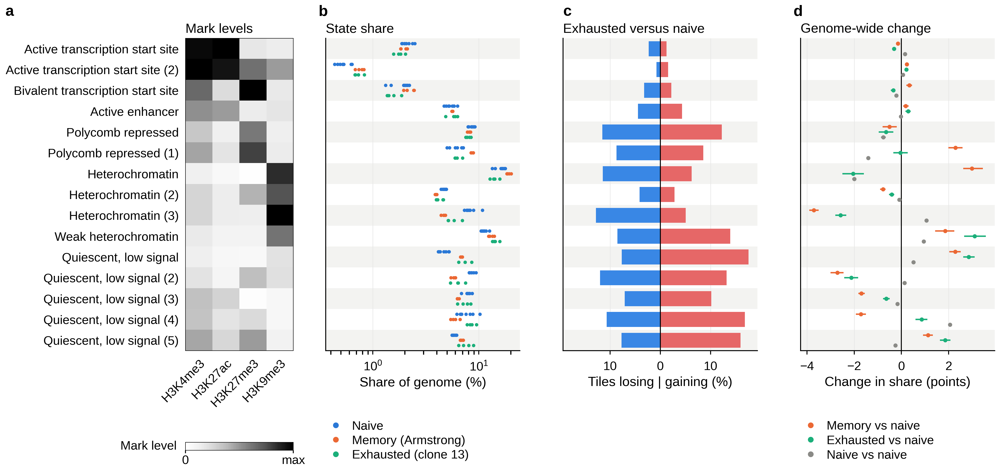
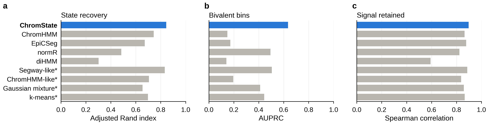
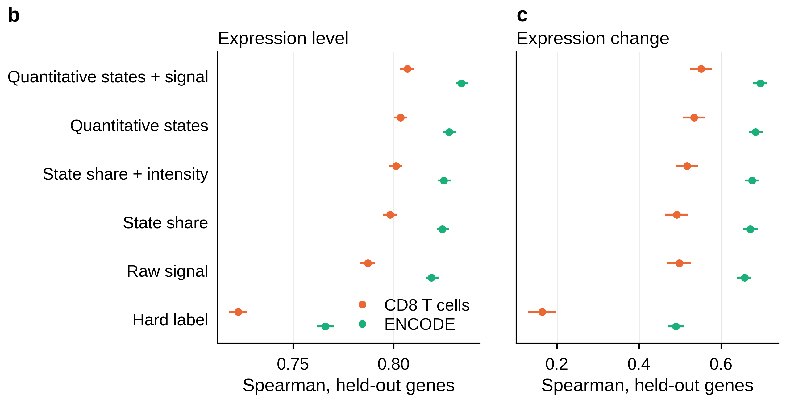

# ChromState: quantitative chromatin state analysis

[](https://github.com/helenhuangmath/ChromState/releases)
[](pyproject.toml)
[](LICENSE)

**Documentation and tutorials: <https://helenhuangmath.github.io/ChromState/>**

[Installation](https://helenhuangmath.github.io/ChromState/docs/INSTALL.html) ·
[Quick start](https://helenhuangmath.github.io/ChromState/docs/quickstart.html) ·
[Tutorials](https://helenhuangmath.github.io/ChromState/docs/tutorial.html) ·
[Command reference](https://helenhuangmath.github.io/ChromState/docs/subcommands_index.html) ·
[Python API](https://helenhuangmath.github.io/ChromState/docs/api/index.html) ·
[Benchmarks](https://helenhuangmath.github.io/ChromState/docs/benchmarks.html) ·
[Changelog](CHANGELOG.md)

## Introduction

Histone modifications combine into chromatin states: active promoters, enhancers,
Polycomb-repressed and bivalent regions, heterochromatin. Tools such as
[ChromHMM](https://doi.org/10.1038/nmeth.1906) assign one state label to each genomic
bin. ChromState keeps the same idea but treats the states as **quantities**.

It fits a hidden Markov model with negative-binomial emissions to raw read counts from
ChIP-seq, CUT&RUN, CUT&Tag or ATAC-seq, jointly across all samples, so a state means the
same thing in every condition. Sequencing depth and spike-in normalisation enter the
model as an offset instead of a rescaling of the data.

For every genomic bin, ChromState reports:

- the probability of each state, with call confidence and entropy;
- a continuous bivalency score, split into magnitude and balance;
- the contribution of each mark to the call.

From these it measures how much of a promoter, gene or any region is in each state,
tests how that changes between conditions with replicates, and ranks the states by how
well they predict gene expression. ChromState is a Python package (`chromstate`) with a
command line and an R interface (`chromstatR`). It reads ChromHMM's input table
unchanged.

## Example results

One model fitted to naive, memory and exhausted CD8 T cells (CUT&RUN, four marks, 16
samples): the mark level of each state, its share of the genome in every replicate, and
the change between conditions with replicate-based intervals.



Recovery of known states on simulated data, against published tools run on the same
bins. The simulation draws counts from the model family ChromState fits, so read it
together with the [real-data benchmarks](https://helenhuangmath.github.io/ChromState/docs/benchmarks.html).



Predicting gene expression from chromatin on held-out chromosomes. A hard state label
loses most of the information about expression change; quantitative states keep it.



All figures, with full legends, are on the
[benchmarks page](https://helenhuangmath.github.io/ChromState/docs/benchmarks.html).

## Installation

ChromState needs Python 3.9 or later on Linux or macOS.

```bash
python -m pip install "chromstate[all] @ git+https://github.com/helenhuangmath/ChromState.git@v1.1"
```

Or from a clone, with pip or conda:

```bash
git clone https://github.com/helenhuangmath/ChromState.git
cd ChromState
pip install -e ".[all]"                  # or: conda env create -f environment.yml
```

`[all]` adds `pysam` (BAM input), `pyBigWig` (bigWig input), `anndata` (single cells)
and `numba` (speed). The R interface is installed with `R CMD INSTALL R/chromstatR`
after the Python package. Details are in the
[installation guide](https://helenhuangmath.github.io/ChromState/docs/INSTALL.html).

## Quick start

Check the installation with the simulated end-to-end run (about 15 s):

```bash
chromstate demo -o demo_out
```

On your own data, describe the samples in a ChromHMM-style table (sample, mark, file,
optional control) and run:

```bash
# 1. choose the number of states
chromstate selectk --manifest cellmarkfiletable.txt --chrom-sizes mm10.chrom.sizes \
                   --candidates 6,8,10,12,15 -o selectk_out

# 2. fit, segment and quantify genes; compare conditions
chromstate run --manifest cellmarkfiletable.txt --chrom-sizes mm10.chrom.sizes \
               --gtf genes.gtf -k 12 \
               --groups "Naive=n1,n2;Exhausted=e1,e2" -o run_out

# 3. link states to expression
chromstate predict --genes run_out/genes/gene_quantification.tsv.gz \
                   --expression rna_tpm.tsv -o predict_out
```

The [quick start](https://helenhuangmath.github.io/ChromState/docs/quickstart.html)
explains each step and shows the same analysis in Python.

## Documentation

| | |
|---|---|
| [Tutorial 1: simulation](https://helenhuangmath.github.io/ChromState/docs/tutorial_simulation.html) | Known ground truth: state recovery, bivalency, perturbation detection, normalisation |
| [Tutorial 2: CD8 T-cell differentiation](https://helenhuangmath.github.io/ChromState/docs/tutorial_cd8.html) | Naive, memory and exhausted cells: states, expression, bivalent promoters |
| [Tutorial 3: expression prediction](https://helenhuangmath.github.io/ChromState/docs/tutorial_expression.html) | Which states predict expression level and its change |
| [User guide](docs/USER_GUIDE.md) | Motivation, input data and every step of the workflow in detail |
| [Algorithm](https://helenhuangmath.github.io/ChromState/docs/algorithm.html) | The statistical model |
| [Commands](https://helenhuangmath.github.io/ChromState/docs/subcommands_index.html) · [File formats](https://helenhuangmath.github.io/ChromState/docs/fileformats_index.html) · [Python API](https://helenhuangmath.github.io/ChromState/docs/api/index.html) | Reference |
| [Benchmarks](https://helenhuangmath.github.io/ChromState/docs/benchmarks.html) · [Tool comparison](docs/tool_comparison.md) | ChromState against ChromHMM, EpiCSeg, normR, diHMM and Segway |
| [Q&A](https://helenhuangmath.github.io/ChromState/docs/qa.html) | Common questions |

## Citation

If you use ChromState in your work, please cite the software:

> Huang H. ChromState: quantitative chromatin state analysis. Version 1.1.0 (2026).
> <https://github.com/helenhuangmath/ChromState>

```bibtex
@software{huang_chromstate_2026,
  author  = {Huang, Hua},
  title   = {ChromState: quantitative chromatin state analysis},
  version = {1.1.0},
  year    = {2026},
  url     = {https://github.com/helenhuangmath/ChromState}
}
```

GitHub's "Cite this repository" button gives the same reference from
[`CITATION.cff`](CITATION.cff).

## Contributing

Bug reports, feature requests and pull requests are welcome. Please use the
[issue tracker](https://github.com/helenhuangmath/ChromState/issues) for problems and
questions, and read [CONTRIBUTING.md](CONTRIBUTING.md) before opening a pull request.
Everyone taking part is expected to follow the [code of conduct](CODE_OF_CONDUCT.md).

## Author

ChromState is developed and maintained by **Hua Huang**
([@helenhuangmath](https://github.com/helenhuangmath)).

## Licence

ChromState is released under the [MIT licence](LICENSE).
